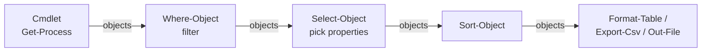

# PowerShell

## Up
- [[Coding]]

Object-oriented shell + scripting language. Unlike [[Bash]] (which passes **text**), PowerShell passes **.NET objects** down the pipeline — so you filter and format on real properties, not string-scraping. **PowerShell 7+** ("Core", `pwsh`) is cross-platform (Windows/Linux/macOS); "Windows PowerShell 5.1" is the older, Windows-only, built-in version.

> Cmdlets are named **`Verb-Noun`** (e.g. `Get-Process`, `Set-Item`). Everything returns objects.

---

## The Basics

```powershell
Get-Command *service*          # discover cmdlets/functions
Get-Help Get-Process -Full     # full help (add -Examples / -Online)
Update-Help                    # download latest help
Get-Member -InputObject $x     # inspect an object's properties & methods
$x | Get-Member                # (pipeline form) — your #1 discovery tool
Get-Alias                      # ls, cd, cat, cp… are aliases to real cmdlets
```

- `$PSVersionTable` — version/edition info.
- **Execution policy** (Windows gate on running scripts):

```powershell
Get-ExecutionPolicy -List
Set-ExecutionPolicy -Scope CurrentUser RemoteSigned   # common dev setting
pwsh -ExecutionPolicy Bypass -File .\script.ps1        # one-off bypass
```

---

## Objects & the Pipeline (the whole point)



```powershell
Get-Process | Where-Object CPU -gt 100 | Sort-Object CPU -Descending |
    Select-Object Name, CPU, Id -First 5

# $_ (or $PSItem) = current pipeline object
Get-Service | Where-Object { $_.Status -eq 'Running' }

# ForEach-Object runs a block per item
1..5 | ForEach-Object { $_ * $_ }        # 1 4 9 16 25
```

> Because it's objects, `Format-*` cmdlets come **last** — once you format, it's text and the pipeline is "dead" for further filtering.

---

## Variables & Types

```powershell
$name = "Ada"              # dynamically typed
[int]$age = 30                 # explicit type
$items = @()                   # empty array
$map   = @{}                   # empty hashtable
$null, $true, $false           # special values

# string interpolation (double quotes only)
"Hello $name, age $($age + 1)"     # $() = subexpression
'Literal $name'                    # single quotes = no interpolation

$env:PATH                      # environment variables
$PWD, $HOME, $PSScriptRoot     # automatic variables
```

Common types: `[string] [int] [double] [bool] [datetime] [array] [hashtable] [pscustomobject] [xml]`.

---

## Operators

| Category | Operators |
|---|---|
| **Comparison** | `-eq -ne -gt -ge -lt -le` (case-insensitive by default; prefix `c` for case-sensitive: `-ceq`) |
| **Matching** | `-like` / `-notlike` (wildcards `*`), `-match` / `-notmatch` (regex), `-contains` / `-in` |
| **Logical** | `-and -or -not` (or `!`) |
| **Arithmetic** | `+ - * / %` |
| **Assignment** | `= += -= *= ++ --` |
| **Type** | `-is`, `-as` (e.g. `$x -is [int]`, `"5" -as [int]`) |
| **Redirection** | `>` `>>` `2>` `2>&1` |

```powershell
"powershell" -match 'shell'          # True, sets $Matches
"file.txt" -like "*.txt"             # True
1,2,3 -contains 2                    # True
```

---

## Strings & Formatting

```powershell
$s.ToUpper(); $s.Trim(); $s.Substring(0,4); $s.Replace('a','b')
$s.Split(','); ($a -join ', '); "a,b,c" -split ','
"{0} scored {1:P1}" -f $name, 0.87   # .NET format strings
$s -replace 'colou?r','color'        # regex replace
"line1`nline2`ttab"                  # `n newline, `t tab (backtick escape)
@"
multi-line
here-string ($name interpolated)
"@
```

---

## Arrays & Hashtables

```powershell
$a = 1,2,3,4                    # or @(1,2,3,4)
$a[0]; $a[-1]; $a[1..2]         # index, last, slice
$a += 5                         # append (creates a new array)
$a.Count; $a -contains 3

$h = @{ name = 'Ada'; age = 30 }
$h['name']; $h.age             # access
$h.city = 'BLR'               # add/set
$h.Keys; $h.Values; $h.ContainsKey('age')

# ordered dictionary (preserves insertion order)
$o = [ordered]@{ first=1; second=2 }

# custom object (great for structured output)
[pscustomobject]@{ Name='web01'; IP='10.0.0.5'; Up=$true }
```

---

## Control Flow

```powershell
if ($age -ge 18) { "adult" } elseif ($age -gt 12) { "teen" } else { "child" }

switch ($x) {
    1        { "one" }
    { $_ -gt 10 } { "big" }
    default  { "other" }
}
switch -Regex ($str) { '^\d+$' { "digits" } }

for ($i=0; $i -lt 5; $i++) { $i }
foreach ($item in $collection) { $item }
while ($cond) { }
do { } until ($cond)

1..10 | ForEach-Object { if ($_ -eq 5){ continue }; $_ }   # break / continue work
```

---

## Functions & Parameters

```powershell
function Get-Square { param([int]$n) $n * $n }
Get-Square -n 7                 # 49  (return = anything left on the pipeline)

# Advanced function: validation, pipeline input, common params (-Verbose, -WhatIf)
function Backup-File {
    [CmdletBinding(SupportsShouldProcess)]
    param(
        [Parameter(Mandatory, ValueFromPipeline)]
        [ValidateNotNullOrEmpty()]
        [string]$Path,

        [ValidateSet('zip','tar')]
        [string]$Format = 'zip'
    )
    process {
        if ($PSCmdlet.ShouldProcess($Path, "Backup as $Format")) {
            Write-Verbose "Backing up $Path"
            # ... work ...
        }
    }
}

# Splatting — pass a hashtable of params (clean long calls)
$params = @{ Path='C:\log'; Recurse=$true; Filter='*.log' }
Get-ChildItem @params
```

---

## Filter / Select / Sort / Group / Measure

```powershell
Get-Process | Where-Object { $_.WS -gt 100MB }        # 100MB/1GB size literals work
Get-Process | Select-Object Name, Id, @{n='Mem(MB)';e={[int]($_.WS/1MB)}}   # calculated property
Get-ChildItem | Sort-Object Length -Descending | Select-Object -First 10
Get-Service | Group-Object Status                     # counts per status
Get-Process | Measure-Object WS -Sum -Average -Max    # stats
Get-Process | Select-Object -Unique
Get-Content big.log | Select-String -Pattern 'ERROR'  # grep equivalent (returns objects)
```

---

## Files, Filesystem & Providers

```powershell
Get-ChildItem -Recurse -Filter *.md                   # ls -R
Get-Content file.txt                                  # cat  (-Raw for one string; -Tail 20)
Set-Content / Add-Content file.txt "text"             # write / append
Test-Path, New-Item, Remove-Item, Copy-Item, Move-Item, Rename-Item
New-Item -ItemType Directory -Path .\out
Get-Item, Get-ItemProperty                            # metadata

# Providers: navigate registry, env, certs like a filesystem
Get-ChildItem Env:\; Get-ChildItem HKLM:\SOFTWARE; Get-ChildItem Cert:\
```

---

## Working with Data (JSON / CSV / XML)

```powershell
Get-Content data.json | ConvertFrom-Json            # → objects
$obj | ConvertTo-Json -Depth 5

Import-Csv users.csv | Where-Object Dept -eq 'IT'
$data | Export-Csv out.csv -NoTypeInformation

[xml]$doc = Get-Content config.xml                  # dot-navigate: $doc.root.node

Invoke-RestMethod https://api.example.com/data      # auto-parses JSON → objects
Invoke-WebRequest https://site -OutFile page.html   # raw HTTP (headers, status, content)
```

---

## Modules & Packages

```powershell
Get-Module -ListAvailable                            # installed modules
Import-Module ActiveDirectory
Find-Module Az | Install-Module -Scope CurrentUser   # from PowerShell Gallery
Update-Module; Get-InstalledModule
```

- Popular: **Az** (Azure — cross-link [[Azure]]), **AWS.Tools** ([[AWS]]), **ActiveDirectory** ([[Active Directory]]), **Pester** (testing), **PSReadLine** (shell UX).

---

## Error Handling

```powershell
try {
    Get-Item missing.txt -ErrorAction Stop           # make non-terminating errors throw
} catch [System.IO.FileNotFoundException] {
    Write-Warning "not found: $($_.Exception.Message)"
} finally {
    "cleanup"
}

$ErrorActionPreference = 'Stop'                       # global: treat errors as terminating
throw "custom error"
$Error[0]                                             # last error object
```

- `-ErrorAction` values: `Continue` (default), `Stop`, `SilentlyContinue`, `Ignore`, `Inquire`.

---

## Remoting & Sessions

```powershell
Enter-PSSession -ComputerName web01                  # interactive remote shell
Invoke-Command -ComputerName web01,web02 -ScriptBlock { Get-Service }
$s = New-PSSession -ComputerName web01               # persistent session
Invoke-Command -Session $s -ScriptBlock { $env:COMPUTERNAME }

# SSH-based remoting (PS 7, cross-platform)
Enter-PSSession -HostName host -UserName user -SSHTransport
```

---

## PowerShell for Windows / AD admin

```powershell
Get-Service, Restart-Service, Set-Service
Get-EventLog -LogName System -Newest 20              # (5.1) / Get-WinEvent (modern)
Get-CimInstance Win32_OperatingSystem                # WMI/CIM system info
Get-ScheduledTask; Register-ScheduledTask
Get-LocalUser; Get-LocalGroupMember Administrators

# ActiveDirectory module (cross-link [[AD Enumeration]])
Get-ADUser -Filter * -Properties MemberOf
Get-ADGroupMember 'Domain Admins'
Get-ADComputer -Filter 'OperatingSystem -like "*Server*"'
```

> Security note: PowerShell is heavily used by both admins and attackers. Defenders lean on **Script Block Logging**, **AMSI**, **Constrained Language Mode**, and JEA. See [[Hacking]] / [[Active Directory]] for the offensive side.

---

## Profiles & Scripting hygiene

```powershell
$PROFILE                          # path to your startup script (aliases, functions, prompt)
#Requires -Version 7.0            # guard at top of a script
Set-StrictMode -Version Latest    # catch uninitialized vars & bad refs
[CmdletBinding()]                 # opt into -Verbose/-Debug/-ErrorAction on your functions
```

---

## Tips
- **`Get-Member` and `Get-Help -Examples`** are your two best friends — learn any cmdlet fast.
- Filter **left**, format **right**: `Where-Object` early, `Format-Table`/`Export-*` last.
- Prefer **full cmdlet names** in scripts (aliases like `?`, `%`, `gci` are for the console).
- Use `[pscustomobject]` to emit structured results your pipeline (and `Export-Csv`) can consume.
- `-WhatIf` / `-Confirm` on destructive cmdlets — dry-run before you commit.
- Size literals (`1KB 1MB 1GB`) and ranges (`1..100`) are built in.
- On Linux/macOS install `pwsh`; most cmdlets that aren't Windows-specific just work.

## Related
- [[Bash]] — the text-pipeline counterpart · [[Python]] — for heavier logic
- [[Azure]] (Az) · [[AWS]] (AWS.Tools) · [[Active Directory]] / [[AD Enumeration]] — admin & security usage
- [[Regex]] *(planned)* — used by `-match` / `-replace` / `Select-String`
