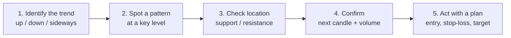

# Candlesticks

## Up
- [[Finance]]

A **candlestick** is a single bar on a price chart that packs **four prices for one time period** — Open, High, Low, Close (**OHLC**) — into one shape. Originating with 18th-century Japanese rice traders, candles make it easy to *see* who won the period: buyers (bulls) or sellers (bears). This note covers the anatomy, the terminology, the common patterns, and worked **bullish** and **bearish** examples.

> Educational reference, not trading advice. A candle shows *what* happened to price, not *why* — always read it in context (trend, support/resistance, volume).

## Contents
- [[#Anatomy of a candle]]
- [[#How to read one candle]]
- [[#Single-candle types]]
- [[#Multi-candle patterns]]
- [[#Worked example — a bullish market]]
- [[#Worked example — a bearish market]]
- [[#Using patterns the right way]]
- [[#Terminology glossary]]

---

## Anatomy of a candle

Each candle has a **real body** (the Open-to-Close range) and two **wicks / shadows** (the thin lines to the High and the Low).

![[Candle Anatomy.excalidraw]]

| Part | What it is |
|---|---|
| **Real body** | The thick rectangle between **Open** and **Close**. Its size = how decisively price moved. |
| **Upper wick (shadow)** | Thin line from the body top up to the **High** — the highest price reached. |
| **Lower wick (shadow)** | Thin line from the body bottom down to the **Low** — the lowest price reached. |
| **Colour** | **Green / white / hollow = bullish** (Close **above** Open). **Red / black / filled = bearish** (Close **below** Open). |

- **Bullish candle:** Open at the **bottom** of the body, Close at the **top** (price rose over the period).
- **Bearish candle:** Open at the **top** of the body, Close at the **bottom** (price fell over the period).
- **Timeframe matters:** one candle = one unit of the chart's timeframe — a 1-minute candle, a daily candle, a weekly candle, etc. Same shapes, different horizon.

---

## How to read one candle

The **body** shows conviction; the **wicks** show rejection.

| What you see | What it suggests |
|---|---|
| **Long body** | Strong, one-sided move (big buyers or big sellers). |
| **Short body** | Indecision / balance between buyers and sellers. |
| **Long lower wick** | Sellers pushed price down but **buyers rejected** it and pushed back up — bullish hint. |
| **Long upper wick** | Buyers pushed up but **sellers rejected** it and pushed back down — bearish hint. |
| **No / tiny wicks** | Price closed near its extreme — momentum in that direction (a *Marubozu*). |
| **Tiny body, long wicks both sides** | Tug-of-war, no winner (*Doji / spinning top*). |

> Rule of thumb: **where price closes within the range is the story.** Closing near the high = bulls in control; near the low = bears in control.

---

## Single-candle types

| Candle | Look | Meaning |
|---|---|---|
| **Marubozu** | Full body, no wicks | Total control by one side (bullish or bearish). |
| **Doji** | Open ≈ Close, tiny body | Indecision; potential turning point (esp. after a big move). |
| **Dragonfly Doji** | Long lower wick, no upper | Sellers rejected — bullish bias (at a bottom). |
| **Gravestone Doji** | Long upper wick, no lower | Buyers rejected — bearish bias (at a top). |
| **Spinning top** | Small body, wicks both sides | Weak indecision. |
| **Hammer** | Small body on top, long lower wick | **Bullish reversal** after a downtrend (buyers fought back). |
| **Hanging Man** | Same shape as Hammer, but after an *uptrend* | **Bearish reversal** warning. |
| **Inverted Hammer** | Small body at bottom, long upper wick, after downtrend | Potential **bullish reversal**. |
| **Shooting Star** | Same shape as Inverted Hammer, but after an *uptrend* | **Bearish reversal**. |

> Note how **shape + prior trend = meaning**: a Hammer and a Hanging Man are the *same candle*; what differs is whether it appears after a down- or up-move.

---

## Multi-candle patterns

![[Candlestick Patterns.excalidraw]]

### Bullish reversal (appear after a downtrend)

| Pattern | Candles | Idea |
|---|---|---|
| **Hammer** | 1 | Long lower wick rejects the lows. |
| **Bullish Engulfing** | 2 | A big green body **fully engulfs** the prior red body — buyers take over. |
| **Piercing Line** | 2 | Red, then a green that opens lower (gap) but closes **above the midpoint** of the red. |
| **Morning Star** | 3 | Red → small indecision candle (star) → strong green. Classic bottom. |
| **Three White Soldiers** | 3 | Three rising green candles with higher closes — strong momentum shift up. |
| **Tweezer Bottom** | 2 | Two candles share almost the **same low** — support holding. |

### Bearish reversal (appear after an uptrend)

| Pattern | Candles | Idea |
|---|---|---|
| **Shooting Star** | 1 | Long upper wick rejects the highs. |
| **Bearish Engulfing** | 2 | A big red body **engulfs** the prior green — sellers take over. |
| **Dark Cloud Cover** | 2 | Green, then a red that opens higher (gap) but closes **below the midpoint** of the green. |
| **Evening Star** | 3 | Green → small star → strong red. Classic top. |
| **Three Black Crows** | 3 | Three falling red candles with lower closes — strong momentum shift down. |
| **Tweezer Top** | 2 | Two candles share almost the **same high** — resistance holding. |

### Continuation (trend pauses, then resumes)

| Pattern | Idea |
|---|---|
| **Rising Three Methods** | Big green, three small red pullbacks *inside its range*, then another big green — uptrend resumes. |
| **Falling Three Methods** | Mirror image — downtrend resumes. |

---

## Worked example — a bullish market

A stock has been falling for days. Watch the OHLC of three consecutive **daily** candles (a **Morning Star** forming at a bottom):

| Day | Open | High | Low | Close | Candle | Reading |
|---|---|---|---|---|---|---|
| **Day 1** | 520 | 522 | 498 | **500** | Big **red** | Sellers still dominant, closes near the low. |
| **Day 2** | 497 | 505 | 495 | **499** | Small body (**star**) | Selling stalls — indecision, tiny range, gaps down slightly. |
| **Day 3** | 502 | 530 | 501 | **528** | Big **green** | Buyers surge, closes near the high, **above Day 1's midpoint (~511)**. |

**What it means:** the heavy selling (Day 1) → exhaustion/indecision (Day 2) → decisive buying (Day 3) is a textbook **Morning Star bullish reversal**. The Day 3 green candle "confirms" the turn.
**Confirmation to look for:** Day 3 (or a Day 4) closing higher on **rising volume**, and price holding above the Day 2 low.

```
Day1(red)   Day2(star)   Day3(green)
  │           │              │
  █            ─            ███
  █                         ███
  █                         ███
  │                          │
 falling  →  indecision  →  reversal up
```

---

## Worked example — a bearish market

A stock has rallied for days. Three daily candles form an **Evening Star** at a top:

| Day | Open | High | Low | Close | Candle | Reading |
|---|---|---|---|---|---|---|
| **Day 1** | 800 | 835 | 798 | **832** | Big **green** | Buyers in control, closes near the high. |
| **Day 2** | 836 | 842 | 833 | **835** | Small body (**star**) | Rally stalls — small range, gaps up but can't push on. |
| **Day 3** | 831 | 833 | 805 | **808** | Big **red** | Sellers take over, closes near the low, **below Day 1's midpoint (~815)**. |

**What it means:** strong buying (Day 1) → indecision at the highs (Day 2) → strong selling (Day 3) is an **Evening Star bearish reversal** — a likely top.
**Confirmation to look for:** Day 3 closing lower on **rising volume**, forming near a known **resistance** level, with the next candle continuing down.

```
Day1(green) Day2(star)  Day3(red)
  │           │             │
 ███          ─             █
 ███                        █
 ███                        █
  │           │             │
 rising   →  indecision →  reversal down
```

---

## Using patterns the right way

A candle pattern is a **hint**, not a guarantee. Combine it with context:



- **Context beats the candle.** The *same* pattern means more at support/resistance or after an extended trend than in the middle of noise.
- **Confirmation.** Wait for the next candle to agree (e.g. a green close after a Hammer) before acting.
- **Volume.** Reversals are stronger when volume expands on the signal candle.
- **Timeframe.** Higher timeframes (daily/weekly) give more reliable signals than 1-minute noise.
- **Risk.** Always pair a setup with a **stop-loss** (often just beyond the pattern's wick) — see [[Finance]] → Stop-Loss.

---

## Terminology glossary

| Term | Meaning |
|---|---|
| **OHLC** | Open, High, Low, Close — the four prices a candle encodes. |
| **Real body** | Open-to-Close range (the rectangle). |
| **Wick / Shadow / Tail** | Thin lines to the High (upper) and Low (lower). |
| **Bullish** | Close above Open (green/hollow); buyers won the period. |
| **Bearish** | Close below Open (red/filled); sellers won the period. |
| **Gap** | Space between one candle's close and the next candle's open (no trading in between). |
| **Reversal pattern** | Suggests the current trend may turn. |
| **Continuation pattern** | Suggests the trend will resume after a pause. |
| **Confirmation** | A follow-through candle/volume that validates the signal. |
| **Marubozu** | Full-body candle with no wicks (strong momentum). |
| **Doji** | Open ≈ Close; indecision. |
| **Support / Resistance** | Price levels where buying / selling tends to halt a move (see [[Finance]]). |
| **Engulfing** | A body that completely covers the prior candle's body. |

## Related
- [[Finance]] — markets glossary (bull/bear, volatility, support/resistance, VWAP…)
- Pairs with technical-analysis tools: RSI, MACD, moving averages (in [[Finance]] → Technical Analysis).
